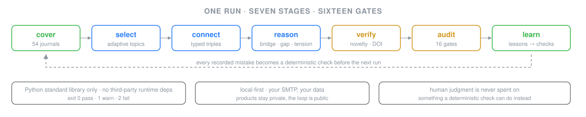

# The Ultimate Form of the Scientific Research Daily


**Most research dailies summarize. This one audits itself.**

A daily is not a summary of what's new. It's a self-correcting loop — cover, select, connect, reason, verify, audit, learn — and the loop, not the topic, is what makes it repeatable.

One invariant runs through every stage: **human judgment is never spent on something a deterministic check can do instead.** Every script exits `0` pass / `1` warn / `2` fail. Every mistake that survives a run gets pushed to one question: *can this become a check, so the next run doesn't need a human to remember it?*



## Why this is different

| Typical AI-generated daily | This repo |
|---|---|
| One prompt, one output | 7 scripted stages, each with an exit code |
| Quality judged by vibes | 16 gates, 7 of them run by scripts |
| Same mistake twice | Lesson → code, before the next run |
| "Looks plausible" citations | DOI resolved against Crossref; retractions checked before send |
| Needs a human to read it | Zero-intervention run; anomalies reported at the end |

## See it run (60 seconds)

```bash
python tools/scan_journals.py --out tmp/scan_results.json       # cover
python tools/select_topics.py --scan tmp/scan_results.json --top 2
python tools/check_report_consistency.py --html HTML/2026-10-28.html
```

A real run, 2026-10-28:

```text
54 journals · 660 in-window items · DOI mismatch 0 · retractions: 8 clean / 1 unverifiable
report: consistency 0 failures, 0 warnings · 9 papers · 2 inline SVG figures
gates: 16/16 exit 0 · tmp cleaned · run log written · committed
```

## The 16 gates

| # | Gate | Question it kills |
|---|---|---|
| 1 | Timeliness | Is every paper inside the window? (30-day red line) |
| 2 | Data truth | Do all DOIs resolve to the quoted titles? |
| 3 | Topic choice | Did the selector avoid recently covered topics? |
| 4 | Skill coverage | Are all five skill classes present and callable? |
| 5 | Report completeness | Are all required blocks there? |
| 6 | Number consistency | Do declared counts match actual cards? |
| 7 | Process efficiency | Did anything degrade silently? |
| 8 | Delivery | Did the email actually leave the SMTP server? |
| 9 | Self-consistency | `check_report_consistency.py` — cards, dates, references |
| 10 | Retractions | `check_retractions.py` — before sending, not after |
| 11 | Closure health | `check_closure_health.py` — lessons actually retire |
| 12 | Memory | `memory.py check` — findings within contract |
| 13 | Reasoning engine | `check_engine_health.py` — bridge precision, not volume |
| 14 | Audit independence | `check_self_review.py` — claims traceable to facts |
| 15 | Paper-line threshold | Is a manuscript audit actually warranted? |
| 16 | Retrieval health | `check_retrieval.py` — journals/entities still resolve |

## What's inside

```text
AGENTS.md + rules/     The constitution: root goal, priority-0 discipline, lazy-mode questions
tools/                 21 stdlib-only scripts: scan, select, connect, reason, verify, render, audit, learn
.agents/skills/        13 skills: bioinformatics doers + thinking, writing, and audit layers
learning/              lessons.md (≤10 active), run logs, improvement proposals
```

The pivotal piece is `hypothesis-paper-audit/` — a fifteen-dimension adversarial review for manuscripts, with an entry threshold (bridge score, falsifiable prediction, novelty), its own lessons file, and a passing example.

## Quickstart

```bash
git clone git@github.com:question666777/The-Ultimate-Form-of-the-Scientific-Research-Daily.git
cd The-Ultimate-Form-of-the-Scientific-Research-Daily
python tools/check_skills.py        # environment + skill health, exit 0 = ready
```

The pipeline needs no third-party runtime dependencies (a few deep-dive skills pull optional extras). To enable the email stage, copy `tools/config.example.ini` to `tools/config.ini` and fill in your own SMTP credentials — never commit the real one.

To run the manuscript audit instead:

```bash
cd .agents/skills/hypothesis-paper-audit
python scripts/check_paper.py
```

## Scope

The loop is public: rules, skills, pipeline, audit gates. The **products** are not: daily reports, manuscripts, submission packages, run logs, and the private findings memory stay with the author. Clone it, point it at your own field, and the loop is yours.

## 中文简介

前沿生物追踪：一套会自我审计的科研日报流水线。七个阶段全部脚本化（退出码 0/1/2），十六道闸门里有七道由脚本自动判定，每一条踩过的坑都会被固化成下一次的检查项。零第三方运行时依赖，本地运行，报告与稿件等产物不入库。仓库里还带一套面向论文的十六维敌意评审技能。

## License

[MIT](LICENSE)
